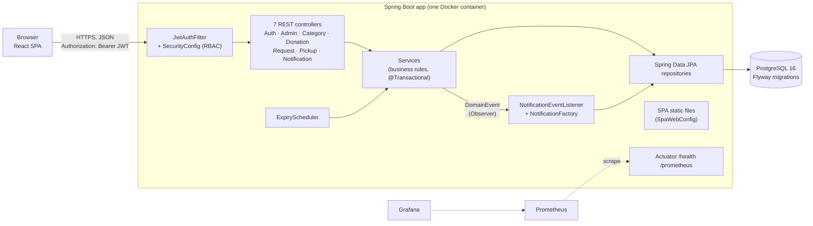
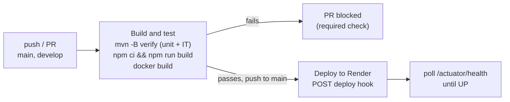

# FoodRescue — Surplus Food Redistribution Coordinator

FoodRescue connects people who have surplus food (restaurants, shops, event organisers) with charities and people in
need, and with volunteers who carry it. A donor posts a batch, a recipient requests part of it, the donor accepts,
a volunteer picks it up and delivers it. Everyone involved is notified at each step, food that passes its expiry time
is expired automatically, and an admin sees statistics and a "food rescued" report.

CSE 3220 Software Engineering Lab project — 3 members. Work split and file ownership: [`docs/TEAM_ALLOCATION.md`](docs/TEAM_ALLOCATION.md).

| | |
|---|---|
| Backend | Java 21, Spring Boot 3.3, Spring Security 6 (JWT + BCrypt), Spring Data JPA / Hibernate, Flyway |
| Database | PostgreSQL 16 |
| Frontend | React 18 + Vite + Tailwind CSS (built into the same Docker image and served by Spring Boot) |
| Tests | JUnit 5 + Mockito (unit), Spring Boot Test + MockMvc + Testcontainers PostgreSQL (integration) |
| DevOps | Docker, Docker Compose, GitHub Actions, Render |
| API docs | Swagger UI at `/swagger-ui.html` |
| Bonus | Spring Boot Actuator + Prometheus + Grafana (compose profile `monitoring`) |

---

## 1. Features and roles

| Role | Can do |
|---|---|
| **DONOR** | create / edit / delete donations (food, category, quantity, unit, expiry, pickup address and window, storage conditions, allergens), see their donations, accept or reject requests |
| **RECIPIENT** | browse and filter available food (category, text, distance, min quantity, expiring before), get recommendations, request a quantity, edit / cancel / remove their requests |
| **VOLUNTEER** | see open pickup tasks, accept or decline, mark picked up and delivered, see pickup history |
| **ADMIN** | manage users (create, edit, enable/disable, change role, delete unused accounts), manage food categories, dashboard statistics and the rescued-food report, download reports as CSV / text |

Business rules enforced in the backend (and covered by tests):

* expired, cancelled or fully allocated donations cannot be requested;
* accepting a request can never allocate more than is left — the donation row is locked (`SELECT … FOR UPDATE`) while the quantity is reserved;
* donation, request and pickup statuses only move along valid transitions (see §5 State pattern);
* a cancelled accepted request releases its quantity and cancels its pickup;
* a scheduler expires donations whose expiry time has passed and warns donors shortly before.

> Role names map to the guideline's example roles: DONOR ≈ SELLER, RECIPIENT ≈ BUYER, plus VOLUNTEER and ADMIN.

---

## 2. Architecture

One Spring Boot application, layered per module (`controller → service → repository → entity`, DTOs at the edges).
Modules talk to each other only through small interfaces in `contract/` and through domain events, so each
member's module can be developed and tested on its own.



Package layout (`backend/src/main/java/com/foodrescue`):

```
common/        BaseEntity, ApiResponse, ApiException, GlobalExceptionHandler, SPA config      (Member 1)
security/      SecurityConfig, JwtService, JwtAuthFilter, CurrentUser                          (Member 1)
user/          User, Role, AuthService, UserService, AuthController, UserDirectoryAdapter       (Member 1)
admin/         AdminService, ReportService, AdminController, report/ (Bridge export)           (Member 1)
contract/      UserDirectory (M1) · DonationInventoryService, DonationView, domain events (M2)
donation/      Donation, FoodCategory, Allergen, services, controllers, catalog/ (Proxy)       (Member 2)
discovery/     DiscoveryService, RecommendationService, strategies + factory, DistanceCalculator (Member 2)
expiry/        ExpiryScheduler, ExpiryService                                                  (Member 2)
request/       DonationRequest, RequestService, RequestController                              (Member 3)
pickup/        PickupTask, PickupService, PickupController                                     (Member 3)
notification/  Notification, NotificationFactory, flyweight/ templates, listener, controller    (Member 3)
```

Every response uses the same envelope:

```json
{ "success": true,  "data": { … }, "timestamp": "2026-11-16T10:00:00Z" }
{ "success": false, "error": { "code": "QUANTITY_EXCEEDED", "message": "…", "fields": { "quantity": "…" } }, "timestamp": "…" }
```

`GlobalExceptionHandler` (`@RestControllerAdvice`) maps `ApiException`, validation errors (400 + field map),
malformed JSON / wrong parameter types (400), `AccessDeniedException` (403), authentication errors (401), unknown paths (404) and anything else (500, no stack trace leaked).

---

## 3. Database (8 tables, Flyway)

```mermaid
erDiagram
  users ||--o{ donations : "donates (1:M)"
  food_categories ||--o{ donations : "categorises (1:M)"
  donations }o--o{ allergens : "contains (M:M via donation_allergens)"
  donations ||--o{ donation_requests : "is requested in (1:M)"
  users ||--o{ donation_requests : "requests (1:M)"
  donation_requests ||--o| pickup_tasks : "is carried by (1:1)"
  users ||--o{ pickup_tasks : "volunteers for (1:M)"
  users ||--o{ notifications : "receives (1:M)"

  users { bigint id PK; varchar email UK; varchar password_hash; varchar role; boolean enabled; int token_version; float lat; float lng }
  food_categories { bigint id PK; varchar name UK }
  allergens { bigint id PK; varchar name UK }
  donations { bigint id PK; bigint donor_id FK; bigint category_id FK; varchar food_name; numeric quantity_total; numeric quantity_available; varchar unit; timestamptz expiry_at; varchar status }
  donation_allergens { bigint donation_id PK; bigint allergen_id PK }
  donation_requests { bigint id PK; bigint donation_id FK; bigint recipient_id FK; numeric quantity_requested; varchar status }
  pickup_tasks { bigint id PK; bigint request_id FK; bigint volunteer_id FK; varchar status; timestamptz collected_at; timestamptz delivered_at }
  notifications { bigint id PK; bigint user_id FK; varchar type; text message; boolean read_flag }
```

Relationships in JPA (inside the donation module): `Donation @ManyToOne FoodCategory` (M:1),
`FoodCategory @OneToMany(mappedBy = "category") List<Donation>` (1:M), `Donation @ManyToMany Set<Allergen>` with
`@JoinTable(name = "donation_allergens")` (M:M). References that cross a member's module boundary (donor, recipient,
volunteer, request) are kept as foreign-key ids (`donorId`, `donationId`, …) with real FK constraints in the database,
so one member's entities never import another member's classes.

| Migration | Owner | Content |
|---|---|---|
| `V1__shared_schema.sql` | Member 1 (agreed by all in Phase 1) | users, food_categories, donations, donation_requests, pickup_tasks, notifications |
| `V10__user_token_version.sql` | Member 1 | `users.token_version` (server-side logout) |
| `V20__seed_food_categories.sql` | Member 2 | default categories |
| `V21__allergens_many_to_many.sql` | Member 2 | allergens + donation_allergens, 14 standard allergens |

`ddl-auto` is `none`; Hibernate never changes the schema, Flyway does.

---

## 4. Security

* **Registration / login** — `POST /api/auth/register`, `POST /api/auth/login` return a JWT (HS256, 2 h by default, `JWT_EXPIRATION_MINUTES`). Passwords are stored with `BCryptPasswordEncoder`.
* **Logout** — `POST /api/auth/logout` increments `users.token_version`; the token's `ver` claim no longer matches, so `JwtAuthFilter` rejects every token issued before logout. (JWT stays stateless; no token table.)
* **Role-based authorisation, two layers**
  * URL rules in `SecurityConfig`: `/api/auth/**` public, `/api/admin/**` ADMIN, `/api/**` authenticated, `/actuator/**` ADMIN except health/info/prometheus.
  * Method rules with `@PreAuthorize("hasRole('DONOR')")` etc. on every controller method (table below).
* **Ownership checks** in services (a donor can only edit their own donation, a volunteer only their own pickup) → 403.
* No credentials in the code: `DB_PASSWORD` and `JWT_SECRET` have no defaults, the app refuses to start without them.

---

## 5. Design patterns (where and why)

All six patterns from the lab handout (Singleton, Factory, Adapter, Bridge, Proxy, Flyweight) are implemented in
the same shape as the lab examples, each with a real job in the app; the class Javadoc of each names the matching
lab class (e.g. *"the lab's `ProxyImage`"*). Each has a unit test that demonstrates the pattern.

### 5.1 Patterns from the lab handout

| Pattern (lab example) | Where | Role of each class | Why here | Test |
|---|---|---|---|---|
| **Singleton** (`Singleton.getInstance()`) | `discovery/util/DistanceCalculator` | private constructor, `private static DistanceCalculator instance`, `static synchronized getInstance()` creating it on first use | search, recommendations and the distance strategy all need one stateless Haversine calculator | `DistanceCalculatorTest` |
| **Factory** (`ShapeFactory.getShape("SQUARE")`) | `discovery/strategy/MatchingStrategyFactory` | product interface `MatchingStrategy`; concrete products `DistanceMatchStrategy`, `CategoryMatchStrategy`, `ExpiryUrgencyStrategy`; `getStrategy("DISTANCE")` | `RecommendationService` only names the criteria it wants; a new criterion = one class + one branch | `MatchingStrategyTest.factoryCreatesTheRequestedStrategy` |
| **Adapter** (`Car` → `Railroad`) | `user/adapter/UserDirectoryAdapter` | target `contract/UserDirectory` (what Member 3 needs), adaptee `UserRepository` (what Member 1 has), adapter implements the target and calls the adaptee | request/pickup code must not touch the `User` entity or repository; the interfaces do not match | `UserDirectoryAdapterTest` |
| **Bridge** (`Shape` + `Color`) | `admin/report/` | abstraction `ExportableReport` holds a `ReportFormat`; refined abstractions `RescuedFoodReport`, `DashboardStatsReport`; implementors `CsvReportFormat`, `TextReportFormat` | 2 reports × 2 formats would need 4 classes, growing multiplicatively; with the bridge each side grows alone. Used by `GET /api/admin/reports/{report}/export?format=csv\|txt` | `ExportableReportTest`, `AdminControllerIT` |
| **Proxy** (`ProxyImage` / `RealImage`) | `donation/catalog/` | interface `AllergenCatalog`; real subject `RealAllergenCatalog` loads from the database in its constructor; `AllergenCatalogProxy` creates it only on the first `list()` | the 14 allergens are fixed reference data but the donation form asks for them every time | `AllergenCatalogProxyTest` |
| **Flyweight** (`ShapeFactory.getCircle(color)` with a `HashMap`) | `notification/flyweight/` | flyweight `NotificationTemplate` (intrinsic: type, text pattern, reference kind — immutable); `NotificationTemplateFactory.getTemplate(key)` returns the cached instance or creates it once; extrinsic state (receiver, food name, ids) is passed to `create(...)` | every request/pickup/expiry event produces notifications from only 11 kinds of message, so 11 shared objects serve them all | `NotificationFactoryTest.templatesAreSharedNotRecreated` |

### 5.2 Further patterns already in the design

| Pattern | Where | Why |
|---|---|---|
| **State** | `DonationStatus`, `RequestStatus`, `PickupStatus` — each enum owns its allowed transitions (`canTransitionTo`, `requireTransition`) | invalid transitions (e.g. DELIVERED → OPEN) are rejected in one place instead of `if`s scattered in services |
| **Strategy** | `MatchingStrategy` and its three implementations, combined (weighted) by `RecommendationService` | the ranking rule can change or grow without touching the service |
| **Observer** | services publish `DomainEvent`s; `NotificationEventListener` handles them `@TransactionalEventListener(AFTER_COMMIT)` | request/pickup code does not know notifications exist; notifications only for committed changes |
| **Factory** (second use) | `notification/factory/NotificationFactory` — decides which notifications (and for whom) each event produces, using the flyweight templates | one place maps events to messages; the `switch` over the sealed `DomainEvent` must cover every event |
| **Facade** | `contract/DonationInventoryService` | Member 3 reserves/releases stock through one narrow interface that hides locking and status rules |
| **Repository, DTO, Builder** | Spring Data repositories, request/response records, Lombok `@Builder` | standard layering; entities never leak to the API |

Note: Spring beans are singletons managed by the container. `DistanceCalculator` is deliberately a plain class
with the classic hand-written Singleton, as taught in the lab, because it needs no Spring features.

---

## 6. REST API

All endpoints are under `/api`, JSON, `Authorization: Bearer <token>` unless marked public. Full schemas in Swagger UI.

| Method | Path | Role | Description |
|---|---|---|---|
| POST | /api/auth/register | public | register (DONOR, RECIPIENT, VOLUNTEER) → 201 + token |
| POST | /api/auth/login | public | login → token |
| POST | /api/auth/logout | any | revoke current tokens → 204 |
| GET / PUT | /api/users/me | any | view / update own profile |
| GET | /api/admin/users | ADMIN | list users (filter by role, paged) |
| GET / PUT / DELETE | /api/admin/users/{id} | ADMIN | view / edit / delete a user (409 if the user has activity) |
| POST | /api/admin/users | ADMIN | create a user with any role |
| PATCH | /api/admin/users/{id}/status · /role | ADMIN | enable/disable · change role |
| GET | /api/admin/stats · /api/admin/reports/rescued | ADMIN | dashboard numbers · rescued-food report |
| GET | /api/admin/reports/{rescued-food\|statistics}/export?format=csv\|txt | ADMIN | download a report as a CSV or text file |
| GET | /api/categories · /api/categories/{id} | any | list / get categories |
| POST / PUT / DELETE | /api/categories(/{id}) | ADMIN | create / rename / delete (409 if in use) |
| GET | /api/allergens | any | allergen list |
| POST | /api/donations | DONOR | create donation → 201 |
| PUT / DELETE | /api/donations/{id} | DONOR (owner) | update / delete (cancel) |
| GET | /api/donations/mine | DONOR | own donations |
| GET | /api/donations | any | browse available donations (`category, q, minQty, expiryBefore, lat, lng, radiusKm, page, size`) |
| GET | /api/donations/recommended | RECIPIENT | ranked by the matching strategies |
| GET | /api/donations/{id} | any | donation detail |
| POST | /api/donations/{id}/requests | RECIPIENT | request a quantity → 201 |
| GET | /api/donations/{id}/requests | DONOR (owner) | requests for a donation |
| GET | /api/requests/mine | RECIPIENT | own requests |
| GET | /api/requests/{id} | donor, recipient or ADMIN | request detail |
| PUT / DELETE | /api/requests/{id} | RECIPIENT | edit (PENDING only) / remove (closed only) |
| PATCH | /api/requests/{id}/accept · /reject | DONOR (owner) | decide; accept reserves quantity and opens a pickup |
| PATCH | /api/requests/{id}/cancel | RECIPIENT | cancel (PENDING or ACCEPTED) |
| GET | /api/pickups/open · /api/pickups/mine | VOLUNTEER | open tasks · own history |
| PATCH | /api/pickups/{id}/accept · /decline · /picked-up · /delivered | VOLUNTEER | pickup lifecycle |
| GET | /api/notifications · /unread-count | any | own notifications |
| PATCH | /api/notifications/{id}/read · /read-all | any | mark as read |

CRUD for ≥3 entities: **User** (admin), **FoodCategory**, **Donation**, **DonationRequest**.

---

## 7. Running it

### 7.1 Docker Compose (recommended — app + PostgreSQL)

```bash
cp .env.example .env          # then edit the passwords and JWT_SECRET (openssl rand -base64 48)
docker compose up --build
```

* App + UI: http://localhost:8080  · Swagger: http://localhost:8080/swagger-ui.html · Health: http://localhost:8080/actuator/health
* Admin login: `ADMIN_EMAIL` / `ADMIN_PASSWORD` from `.env`.
* Demo data (10 users `…@seed.local` with password `Password123`, donations, requests, pickups): `sh scripts/seed.sh` — remove with `sh scripts/seed.sh remove`.

With monitoring (bonus): `docker compose --profile monitoring up --build` → Prometheus http://localhost:9090, Grafana http://localhost:3000 (admin / `GRAFANA_ADMIN_PASSWORD`, dashboard "FoodRescue" pre-provisioned).

### 7.2 Local development without Docker for the app

```bash
docker compose up -d db                                         # or any PostgreSQL 16
cd backend
DB_PASSWORD=<pw> JWT_SECRET=<32+ chars> ADMIN_PASSWORD=Admin123! mvn spring-boot:run
cd ../frontend && npm install && npm run dev                    # http://localhost:5173, /api proxied to :8080
```

Environment variables: `DB_HOST, DB_PORT, DB_NAME, DB_USER, DB_PASSWORD` (or `DB_URL`), `JWT_SECRET`, `ADMIN_EMAIL`, `ADMIN_PASSWORD`, `PORT`.

### 7.3 Tests

```bash
cd backend
mvn test        # 34 unit tests (*Test, JUnit 5 + Mockito) — no database needed
mvn verify      # + 14 integration tests (*IT, @SpringBootTest + MockMvc) against a Testcontainers PostgreSQL 16 — needs Docker
```

| Member | Unit tests | Integration tests |
|---|---|---|
| 1 — platform | AuthServiceTest (5), JwtServiceTest (2), AdminServiceTest (2), UserDirectoryAdapterTest (1), ExportableReportTest (1) | AuthControllerIT (3), AdminControllerIT (2) |
| 2 — donation | DonationServiceTest (4), DonationInventoryServiceImplTest (3), DonationStatusTest (1), CategoryServiceTest (1), MatchingStrategyTest (2), DistanceCalculatorTest (1), AllergenCatalogProxyTest (1) | DonationControllerIT (3), CategoryControllerIT (1) |
| 3 — distribution | RequestServiceTest (4), PickupServiceTest (3), PickupStatusTest (1), NotificationFactoryTest (2) | RequestControllerIT (3), PickupControllerIT (2) |

24 of the 34 unit tests are service-layer tests (AuthService, JwtService, AdminService, DonationService, DonationInventoryService, CategoryService, RequestService, PickupService); the rest test the state machines and the design-pattern classes.

---

## 8. Git workflow

`main` (protected, deployed to Render, only release PRs from `develop`) · `develop` (protected, integration branch) ·
seven `feature/*` branches, worked on in **four rounds**. PRs of the same round are independent and are open at the
same time; each round only needs the rounds before it.

| Round | Member 1 (Team Lead) | Member 2 | Member 3 |
|---|---|---|---|
| 1 | `feature/platform-core` — build, Docker, schema V1/V10, common, security, users, UserDirectory Adapter, auth tests, UI shell, CI, README | — | — |
| 2 | `feature/admin-reports` — admin API, Bridge report export, admin tests, admin & reports pages | `feature/donation-core` — V20/V21, entities, contract & events, Singleton, Factory, strategies, Proxy, services, controllers, expiry, tests | — |
| 3 | (reviews) | `feature/donation-ui` — food components, donation, browse, recommendations, categories pages | `feature/request-pickup-notification` — requests, pickups, Flyweight, notifications, tests, CI fail→fix demo |
| 4 | `feature/monitoring-docs` — Prometheus, Grafana, team allocation | — | `feature/distribution-ui` — request, pickup, notification pages, demo seed |
| then | release PR `develop` → `main`, Render deployment | | |

Branch protection on `main` and `develop` (GitHub → Settings → Branches, or `scripts/setup-github.sh`): pull request
required, **1 approving review**, status check **Build and test** must pass, branch must be up to date, rules apply to
admins too, no force pushes. Nobody pushes to `main` or `develop` directly.

Flow: `feature/*` → PR into `develop` (CI + 1 review) → merge (merge commit) → release PR `develop` → `main` (CI + 1 review) → deploy.
Commits follow [Conventional Commits](https://www.conventionalcommits.org): `feat(scope): …`, `fix(scope): …`, `test(scope): …`, `docs: …`, `ci: …`, `chore: …`.
Every member's README lists the exact `git add` / `git commit` commands of each of their PRs.

---

## 9. CI/CD (`.github/workflows/ci.yml`)



* **Build and test** runs on every push and PR to `main` / `develop`: all 48 tests (integration tests use Testcontainers — Docker is available on GitHub runners), the frontend build and the Docker image build. Test reports are uploaded as an artifact.
* **Deploy to Render** runs only after a push to `main` (i.e. a merged release PR) and only if the first job passed.
* Branch protection makes the check required, so a red pipeline blocks the merge.

### Deploying to Render (one time)

1. Push the repository to GitHub. In Render: **New → Blueprint** → select the repo. `render.yaml` creates a free PostgreSQL database `foodrescue-db` and a Docker web service `foodrescue` (health check `/actuator/health`, `autoDeploy: false` so only CI deploys).
2. In the web service's **Environment**, set `ADMIN_PASSWORD` (`JWT_SECRET` is generated, DB variables come from the database).
3. Service **Settings → Deploy Hook** → copy the URL. In GitHub **Settings → Secrets and variables → Actions**: secret `RENDER_DEPLOY_HOOK_URL` = that URL; variable `RENDER_APP_URL` = `https://<your-service>.onrender.com`.
4. Merge a PR into `main` → the Deploy job triggers Render and waits until the new version reports healthy.

(Free Render instances sleep when idle; the first request can take ~1 minute.)

### Demonstrating a failing pipeline

On a feature branch, break a rule on purpose, e.g. in `RequestService.accept` remove the quantity check, commit
`test(request): demo – break over-allocation guard`, push, open the PR → **Build and test** fails
(`RequestServiceTest` / `RequestControllerIT`) and the merge button is blocked. Revert with
`fix(request): prevent donation quantity over-allocation`, push → pipeline green → approve and merge.

---

## 10. Guideline compliance

| Requirement | Where |
|---|---|
| Registration, login, logout, BCrypt | `AuthController`, `AuthService`, `SecurityConfig` (BCryptPasswordEncoder), token_version logout |
| Role-based authorisation (URL + method level) | `SecurityConfig` URL rules + `@PreAuthorize` on controllers |
| REST, ≥ 5 controllers | 7 controllers (§6) |
| CRUD for ≥ 3 entities | User, FoodCategory, Donation, DonationRequest |
| Global exception handling | `GlobalExceptionHandler` + `ApiException` + common `ApiResponse` |
| ≥ 6 tables, 1:M, M:1, M:M | 8 tables (§3): FoodCategory 1:M Donation, Donation M:1 FoodCategory, Donation M:M Allergen |
| ≥ 20 unit tests (service layer), ≥ 10 integration tests (controller layer) in CI | 34 unit (24 of them service layer), 14 integration with MockMvc + `@SpringBootTest` (§7.3), run by `mvn verify` in CI |
| Dockerfile + compose (app + PostgreSQL), env vars, `docker compose up --build` | `Dockerfile`, `docker-compose.yml`, `.env.example` |
| main protected, develop, feature branches, PR with ≥ 1 approval | §8, `scripts/setup-github.sh` |
| GitHub Actions build/test/deploy from main | §9 |
| Deployment | Render (`render.yaml`) |
| Design patterns | §5: all six lab patterns (Singleton, Factory, Adapter, Bridge, Proxy, Flyweight) + State, Strategy, Observer, Facade |
| Bonus: monitoring | Actuator + Prometheus + Grafana |
| Bonus: deployment on a second platform | not included (optional) |
| Roles ADMIN / SELLER / BUYER | ADMIN / DONOR (seller side) / RECIPIENT (buyer side), plus VOLUNTEER (§1) |

## 11. Verification status (honest)

Verified while preparing this package: Flyway migrations V1–V21 apply on PostgreSQL 16 and produce the 8 tables;
every JPA entity column matches the schema; the demo seed and un-seed scripts run cleanly; the frontend production
build succeeds; all YAML files (compose, CI, Render, monitoring) parse. The framework-free design-pattern classes
(DistanceCalculator, the report Bridge classes, the notification Flyweight) were compiled with `javac` and their
behaviour checked (same instance, CSV/text output incl. escaping, template sharing and message text).

Not executed in the preparation environment (no Maven Central access and no Docker daemon there): the Maven build,
the 48 Java tests, `docker compose up --build`, the GitHub Actions run and the Render deployment. Run `mvn verify` and
`docker compose up --build` once locally before the first push; the first CI run on GitHub is the authoritative check.
